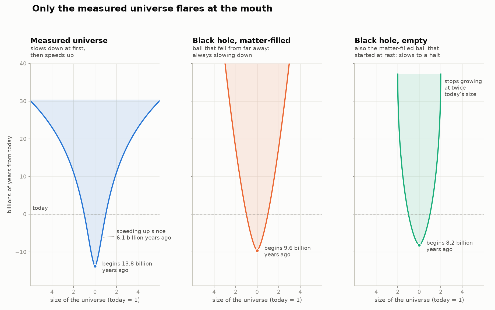
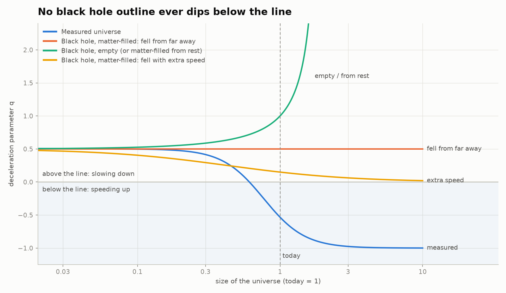

# Experiment 001: funnel outline

**Tests claim:** C3 of [theory 001](../../README.md), with a side check on C1
**Status:** done
**Date:** 2026-11-17

## Question

Does the inside of a black hole, flipped in time, grow the way our universe has grown: slowing down at first, then speeding up?

## Background in one paragraph

The theory pictures the universe as the wall of a funnel, with depth as time. The width of the funnel at each depth is the size of the universe at that time, so the funnel's outline is the expansion history. Claim C3 says the funnel flares toward the mouth, and that this flare is the accelerating expansion astronomers measure. General relativity gives a definite outline for a black hole's inside, so we can draw it and compare.

## The outlines being compared

| Name | What it is |
|------|------------|
| Measured universe | The expansion history that fits the observations: the standard model with the Planck 2018 parameter set, taken from `astropy`. This stands in for the data |
| Empty black hole | The inside of a black hole with nothing in it (the Schwarzschild solution), run backwards in time. Space here has two directions that follow the radius and a third that behaves differently |
| Matter-filled black hole | The inside of a collapsing ball of pressureless matter (the Oppenheimer–Snyder model), run backwards in time. Three variants, depending on whether the ball started at rest, fell from far away, or fell with extra speed |

## Measures

- **Flare.** The deceleration parameter q, which is positive when expansion is slowing and negative when it is speeding up. The measured universe has q below zero today.
- **Evenness.** The expansion rate along the odd direction divided by the rate along the other two. An even expansion gives exactly 1. Our universe is even to far better than 1%.
- **Implied age.** How old each model says the universe is, once it is matched to today's measured expansion rate. Recorded for interest; not a kill condition.

## Prediction

Written before any code was run.

If C3 is true, at least one black hole outline has a stretch where q is negative, following a stretch where it is positive.

Claude's own expectation, recorded so it can be held to account: no version will show this. The reason is a general result in relativity, that ordinary matter and empty space can only slow an expansion down. By-hand working (journal, 2026-11-17 entry 2) gives q of at least 1/2 for the empty black hole and for two of the matter-filled variants, and between 0 and 1/2 for the third. Claude also expects the empty black hole's odd direction to shrink while the other two grow.

## Kill conditions

Written before any code was run.

- **K1, flare.** A version is ruled out as the source of the acceleration if q is never negative anywhere in its history. This does not depend on the black hole's size or on where "today" sits in the funnel, so no tuning can save a version that fails it.
- **K2, evenness.** A version is ruled out as a description of our universe if its evenness ratio is further than 1% from 1 at every point in its history.

If every version fails K1, claim C3 is refuted in its plain form: a black hole described by standard relativity alone does not produce the flare. The theory would then need an extra ingredient, and the next step is to look at proposals for what that ingredient is.

A single version with a negative-q stretch would count as support for C3 and would be a surprise worth checking hard.

## Method

One script, `run.py`, in two parts.

**Symbolic part.** The equations are derived from the geometry with `sympy` instead of being typed in from memory.
- Empty black hole: start from the Schwarzschild solution written for the inside of the horizon, where the radius plays the role of time. Confirm it is a solution for empty space. Confirm that observers who sit still inside are in free fall, so their clocks give a fair "time since the beginning". Then derive how fast each direction of space grows.
- Matter-filled black hole: start from a uniform ball of pressureless matter. Its inside is a Friedmann universe (the Oppenheimer–Snyder result, taken as known). Derive the growth equations for all three variants.

**Numeric part.** Follow each outline over its whole history and record the smallest q it ever reaches. For the matter-filled case this scans 501 variants, from balls that barely hold together to ones that fly apart. For the measured universe, integrate the standard model with the Planck 2018 parameter set from `astropy`.

All models are matched to today's size and today's expansion rate, so the outlines can be laid side by side.

Assumptions and limits:
- "Measured universe" means the standard model that fits the observations, not the raw observations.
- The black holes are the simplest kind: not spinning, not charged.
- Matter has no pressure. Adding pressure makes an expansion slow down more, so it would not help (known result, not tested here).
- Only standard general relativity is used. No quantum effects, no bounce, and no extra term tied to the horizon.

## Calibration

25 checks, all passing. The script stops if any fails; the full list with numbers is in `results/summary.json`.

| What was checked | Against |
|------------------|---------|
| Age of the measured universe from our integrator: 13.787 billion years | `astropy`'s own value for Planck 2018 |
| q today for the measured universe: −0.533 | Textbook formula from the density parameters |
| When speeding-up began: redshift 0.642 | Textbook formula |
| Ages of four matter-only models | Textbook closed-form solutions, to 8 decimal places |
| Clock time inside the empty black hole at three radii, and its total lifetime of π/2 | Exact cycloid formula |
| q for the empty black hole from finite differences on the numeric outline | The symbolic result |
| The inside of the empty black hole is empty space, and still observers there are in free fall | Symbolic, exact |
| Growth equations for the three matter-filled variants | Symbolic, exact |

## How to run

```
uv run run.py
```

Dependencies are pinned in `run.py.lock`. Takes about 15 seconds and rewrites everything in `results/`.

## Result

Run on 2026-11-17. Both figures are in `results/`.





| Outline | Smallest q in its whole history | Ever speeds up? | Evenness ratio | Implied age (billion years) |
|---------|--------------------------------|-----------------|----------------|-----------------------------|
| Measured universe | −1.00 (far future); −0.53 today | Yes, for the last 6.1 billion years | 1 | 13.8 |
| Empty black hole | 0.50 | No | −0.5 at best, worse toward the horizon | 8.2 (if today is halfway to the horizon in size) |
| Matter-filled, started at rest | 0.50 | No | 1 | 8.2 (same example) |
| Matter-filled, fell from far away | 0.50 | No | 1 | 9.6 |
| Matter-filled, fell with extra speed | above 0, approaching it in the far future | No | 1 | 11.7 (example with 30% of the critical density) |

Kill conditions:

| Version | K1, flare | K2, evenness |
|---------|-----------|--------------|
| Empty black hole | **Fails** | **Fails** |
| Matter-filled black hole | **Fails** | Passes |

Other things the run showed:
- The empty black hole's outline and the outline of the matter-filled ball that started at rest are the same curve, to 8 decimal places.
- In the empty black hole the third direction of space shrinks the whole time, at no less than half the rate the other two grow.
- The empty black hole's total lifetime, singularity to horizon, is π/2 times its horizon radius divided by the speed of light. This matches the by-hand figure in the journal.
- Every black hole outline gives a universe younger than the measured 13.8 billion years once matched to today's expansion rate.

## Verdict

**Claim C3 is refuted in its plain form.** A black hole described by standard general relativity, empty or filled with ordinary matter, flipped in time, never produces accelerating expansion. Growth slows toward the mouth; the outline does not flare. Claude's pre-registered expectation held, so there was no surprise to chase.

What kind of evidence this is: an exact consequence of the equations, derived symbolically and confirmed numerically over the whole history of every variant. Within its assumptions it is as close to a proof as this lab gets. It is not a statement about observations beyond the single fact that the measured expansion is speeding up.

What it does not show:
- It does not rule out the universe being inside a black hole. It rules out the black hole's shape being the cause of the acceleration when only standard relativity and ordinary matter are in play.
- It says nothing about versions with an extra ingredient: a term tied to the horizon, quantum effects near the singularity, or dark energy that is simply present inside as well.

**The lesson that points to the next step.** In the matter-filled version, the equations for the inside contain no trace of the horizon. The inside grows exactly as it would if the matter went on forever, so in standard relativity the inside cannot feel how close it is to the mouth. For "nearer the mouth means faster expansion" to hold, something must carry information from the horizon to the inside. Theories that add exactly that exist, and they are where the holographic principle enters. That is the next thing to look up and test.

**A point in the theory's favour (C1).** The inside of an empty black hole really is a universe with a beginning: the radius acts as time, and free-falling clocks start at the singularity. Early on it grows by the same law as our universe's matter era.
